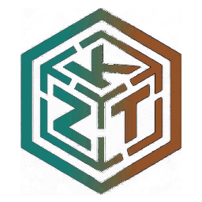
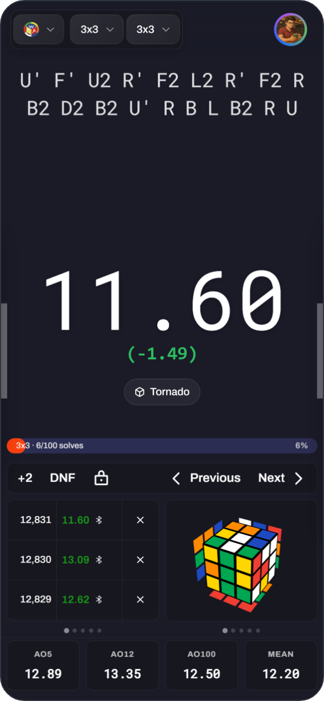
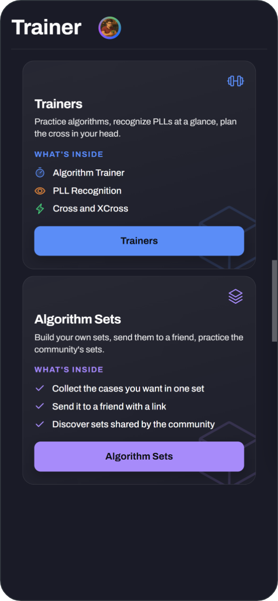
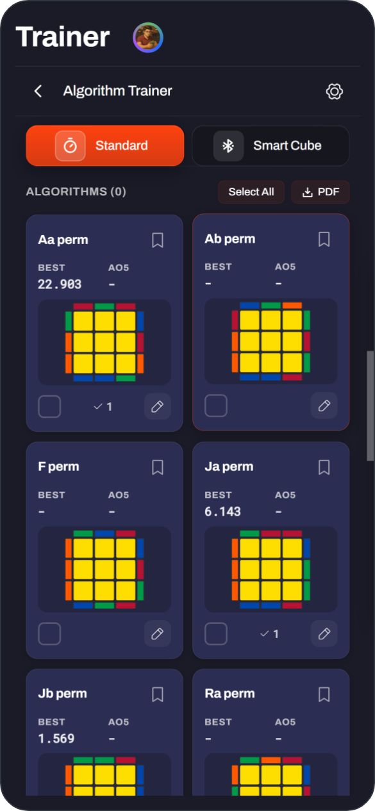
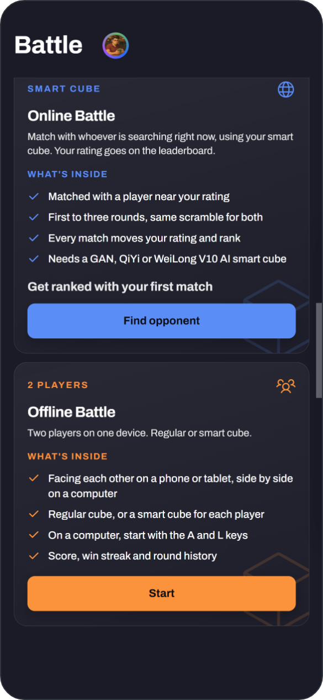
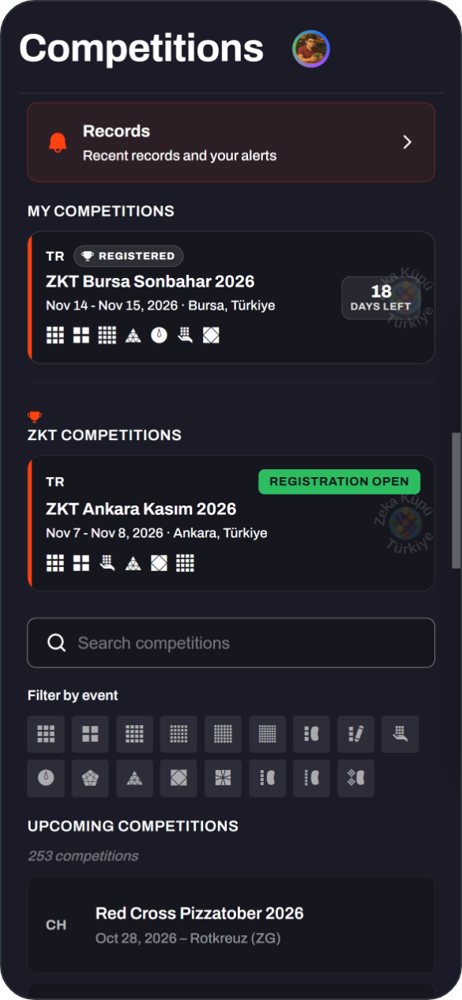
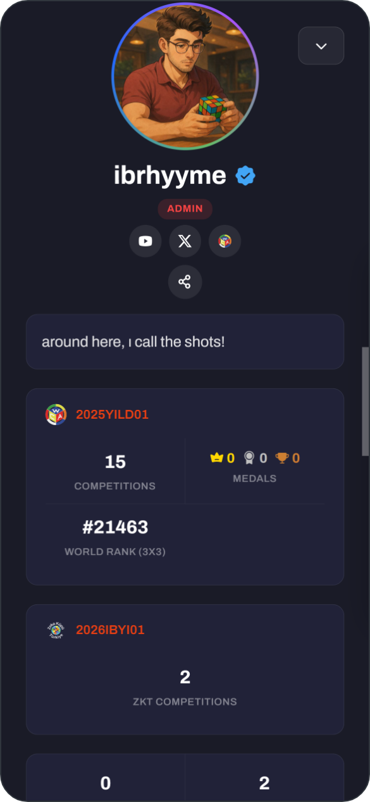
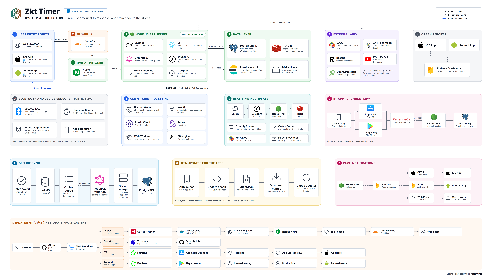

<div align="center">

<picture>
  <source media="(prefers-color-scheme: dark)" srcset="public/images/zkt-logo.png">
  
</picture>

### A complete speedcubing ecosystem, all in one place

A precision timer, Bluetooth smart-cube support, an algorithm trainer, puzzle solvers, rated online battles,
real-time rooms, and live competition tracking. On the web and on native mobile.

Timer · Magnet Timer · Smart Cube · Algorithm Trainer · Puzzle Solvers · Online Battle · Rooms · Competitions

[](https://zktimer.app)
[](https://apps.apple.com/app/zkt-timer/id6760920873)
[](https://play.google.com/store/apps/details?id=com.zktimer.app)
[](LICENSE)

</div>

---

## Overview

Zkt Timer is a full-stack speedcubing platform I have been building for the cubing community since 2025. It
brings everything a cuber needs into a single product: a precision timer with Bluetooth smart-cube support and
a hands-free Magnet Timer, an algorithm trainer with shareable algorithm sets, a full suite of puzzle solvers,
real-time rooms and rated 1v1 online battles, direct messages, and live tracking of WCA and ZKT competitions.
It runs as a server-side rendered web app and as native iOS and Android apps, and it speaks five languages.

My goal is simple: instead of juggling a timer here, a trainer there, and a separate site for competitions,
everything lives under one roof, with your solves, sessions, and progress synced across every device.

## Screenshots

<p align="center">
  
  
  
</p>
<p align="center">
  
  
  
</p>

## Features

### Timer & Input
A precision timer built for serious practice. Time with the keyboard, the touchscreen, or manual entry, with
full WCA inspection (the 15-second countdown, audio cues, haptic feedback, and +2 / DNF penalties). Plug in a
StackMat, GAN Timer, or QiYi Timer for hardware-accurate timing, solve a virtual cube on screen, or use the
native "drop to stop" gesture on mobile to end a solve by setting the phone down.

**Magnet Timer** (iOS and Android) times a solve without touching the screen. The phone lies flat on the table
and its compass sensor picks up the magnets inside the cube: lifting the cube starts the timer and putting it
down stops it. Calibration is done per cube and per phone model, and the detection logic is tested against
recordings from real devices.

### Smart Cubes (Bluetooth)
Connect Bluetooth smart cubes over BLE and watch every turn happen in real time. Cubes from GAN, MoYu, QiYi,
Giiker, GoCube, Xiaomi, Rubik's Connected and others are supported, 2x2 smart cubes included, with a live 3D
cube, gyroscope orientation, MAC discovery, and full move replay. Scramble moves are ticked off as you turn and
a wrong move shows its fix. After a solve you get a Cross / F2L / OLL / PLL breakdown with move count and TPS,
plus per-case statistics for OLL and PLL. The connection stays alive as you move between the timer, rooms, and
the trainer. The protocol parsing logic is adapted from csTimer; the connection layer, reconnect handling,
native BLE adapter for iOS and Android, and the visualization are built for Zkt Timer.

### Algorithm Trainer
Drill OLL, PLL, F2L, ZBLL, OLLCP, and many more algorithm sets, each with its own statistics, smart queue
ordering, and 2D and 3D pattern visualization. I included a dedicated PLL recognition trainer, an efficiency
trainer for cross, xcross, and eocross, smart-cube integration for hands-on drilling, and PDF export so you can
print your algorithm sheets. Build your own algorithm sets from any mix of categories, keep them private, share
them by link, or publish them to Community Sets where others can save them.

### Battle
**Offline Battle** puts two players on one device: facing halves on phones and tablets, side by side with the A
and L keys on desktop, and each player can connect their own smart cube. **Online Battle** matches you with
another smart-cube player who is searching at the same moment. Both solve the same scramble, time comes from the
cube's own clock so network lag never decides a round, the server verifies every solve, and Glicko-2 ratings
feed a public leaderboard.

### Puzzle Solvers
A full suite of step solvers running in Web Workers: Cross, XCross, EOLine, EOCross, Roux first block, Petrus,
ZZ, EODR, 2x2, Pyraminx, Skewb, and Square-1. Generate efficient solutions and study them move by move.

### Statistics & Sessions
Organize your solves into sessions, follow rolling averages and personal bests, and dig into a detailed
statistics page alongside customizable timer modules. Set per-cube-type daily goals with progress tracking and
an activity heatmap, and keep everything synced across devices with full offline support.

### Community & Competitions
Follow WCA and Zeka Küpü Türkiye (ZKT) competitions in one place: groups and assignments, live results, events,
rankings, schedules, and each competitor's duties and personal bests. A records feed shows freshly broken
records, Record Radar flags the records that could fall at an upcoming competition, and notifications follow a
competition from registration to official results. Sign in with your WCA or ZKT account to bring in your
profile, records, and competition history. Play real-time rooms with chat, spectators, and shared scrambles,
talk one to one in Messages with solves you can attach, climb the leaderboards, and share a generated Cuber
Card of your profile.

### Personalization
Pick puzzle colors per puzzle group and every drawing in the app follows them. Put an image or an MP4 video
behind the timer (it pauses while you solve), color your solve list, and on desktop drag the timer screen's
modules into the columns, the bottom strip, or any empty spot.

### Platform
Server-side rendered on the web for fast first loads and strong SEO, and shipped as native iOS and Android
apps through Capacitor, with over-the-air updates so web-layer fixes reach the apps without waiting for store
review. It is fully localized in five languages (Turkish, English, Spanish, Russian, Chinese), with a
three-tier membership model (Free, Pro, Premium), push notifications, and offline-first behavior throughout.

## Architecture

How Zkt Timer fits together, from a user's request to the response and from a commit to the app stores: web
and mobile entry points, Cloudflare and Nginx, the Node.js server (Express, GraphQL, Socket.IO, SSR) with its
PostgreSQL, Redis, and Elasticsearch data layer, the external services it calls, the device-side pieces
(Bluetooth sensors, offline sync, over-the-air updates), push notifications, in-app purchases, and the CI/CD
pipeline.

<div align="center">
  
</div>

**Stack:** React 17 · custom esbuild SSR · type-graphql + Apollo Server · Prisma + PostgreSQL · Redis ·
Socket.IO · Elasticsearch · Capacitor 8 · TypeScript

## Local Development

> Requires Node 20 or newer and Yarn (native builds need Node 22).

```bash
yarn install
yarn graphql-codegen   # generate GraphQL types (run before building)
yarn dev               # client build + server
```

The full stack (PostgreSQL, Redis, app server) runs with `docker compose up`.

## Credits & References

Zkt Timer was built by bringing together work from many open-source projects. Some parts were ported and
adapted, some were rewritten in a different language, and some were designed from scratch for this project.
Each reference is documented individually, stating both what was taken from it and what was built on top.

Full attribution is on the **[Credits page](https://zktimer.app/credits)**, along with the features that were
designed for Zkt Timer itself. My thanks go to the authors and developers of every project listed there.

## License

[GNU General Public License v3.0](LICENSE)
